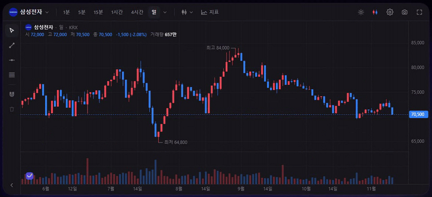
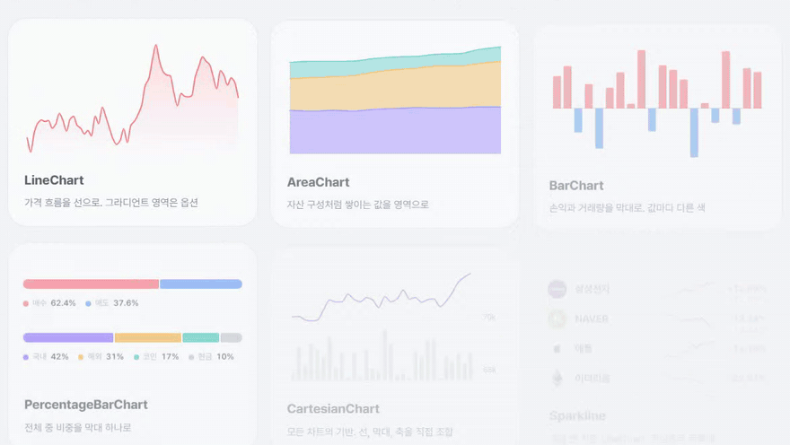

<div align="center">


# Funnest Charts

투자 서비스를 위한 오픈소스 금융 차트 라이브러리예요.\
프로 수준의 트레이딩 차트와 가벼운 대시보드 차트를 내 데이터, 내 디자인으로 써요.

[](https://www.npmjs.com/package/@funnest/charts-react)
[](LICENSE)

[사이트](https://charts.funnest.xyz) · [문서](https://charts.funnest.xyz/docs/) · [English](README.md) | **한국어**

</div>



## 특징

- iframe이 아니라 내 페이지 안에서 동작해요.\
  배경, 글꼴, 상승·하락 색이 내 서비스 디자인을 따라요.
- 평단가, 미체결 주문, 체결 내역을 차트에 표시하고 드래그로 주문 가격을 바꿔요.
- 마우스와 터치 모두 지원해요.\
  핀치 줌, 길게 눌러 십자선, 관성 스크롤이 기본이에요.
- 한국 시장 기본값이 들어 있어요.\
  한국 시간, KRX 장 시간과 호가 단위, 빨간 상승과 파란 하락이에요.
- 특정 거래소 연결 코드는 들어 있지 않아요.\
  `Datafeed` 인터페이스 하나로 어떤 거래소·증권사든 연결해요.

## 시작하기

```bash
npm i @funnest/charts-react
```

```tsx
import { FnChart } from '@funnest/charts-react';

<div style={{ height: 600 }}>
  <FnChart datafeed={myDatafeed} symbol="005930" resolution="1D" />
</div>
```

React에서는 패키지 하나면 돼요.\
엔진, 트레이딩 UI, 차트 계산은 자동으로 같이 설치돼요.

## 대시보드 차트



수익률 카드, 관심종목, 포트폴리오처럼 트레이딩 화면까지는 필요 없을 때 써요.\
SVG로 그려서 서버 렌더링에도 안전해요.

```tsx
import { LineChart, ReferenceLine, Point } from '@funnest/charts-react';

<LineChart series={[{ id: 'price', data: prices }]} area="gradient" scrubber={{ showValues: true }}>
  <ReferenceLine dataY={avgPrice} label="평단가" />
  <Point seriesId="price" dataX={prices.length - 1} pulse />
</LineChart>
```

| 컴포넌트 | 용도 |
|---|---|
| `LineChart` · `AreaChart` · `BarChart` | 가격 흐름, 자산 구성(`stacked`), 손익과 거래량, 가로 막대 순위(`layout="horizontal"`) |
| `PercentageBarChart` | 포트폴리오 비중, 매수·매도 체결 강도, 여러 줄·세로 막대 |
| `CartesianChart` | `Line`, `Area`, `BarPlot`, 축, 표시를 직접 조합, y축 여러 개(`yAxisId`)와 `[low, high]` 범위(띠·떠 있는 막대) |
| `XAxis` · `YAxis` · `Scrubber` · `PeriodSelector` | 축, 값 말풍선이 따라오는 포인터, 기간 탭 |
| `ReferenceLine` · `Point` · `Legend` | 평단가·목표가 선, 매수·매도 표시, 범례 |

## 패키지

| 패키지 | 설명 |
|---|---|
| [`@funnest/charts-react`](packages/react) | React용 `<FnChart />` 트레이딩 차트와 SVG 차트 컴포넌트 |
| [`@funnest/charts-ui`](packages/ui) | 프레임워크와 상관없이 쓰는 트레이딩 차트 위젯(`createTradingChart`) |
| [`@funnest/charts`](packages/core) | Canvas 엔진, 지표, 실시간 연결 도구 |
| [`@funnest/charts-viz`](packages/viz) | 웹과 React Native가 같이 쓰는 차트 계산 |
| [`@funnest/charts-cli`](packages/cli) | `funnest-charts` 명령: 스펙 검사, SVG·PNG·HTML 렌더, React 코드 생성 |
| [`@funnest/charts-mcp`](packages/mcp) | Claude Code, Cursor 같은 AI 도구용 MCP 서버 |

## AI · CLI · MCP

```bash
npx @funnest/charts-cli render spec.json --out chart.png      # 스펙 → PNG / SVG / HTML / React 코드
claude mcp add funnest-charts -- npx -y @funnest/charts-mcp   # Claude Code에 MCP 서버 추가
```

에이전트용 스킬은 [`skills/funnest-charts`](skills/funnest-charts/SKILL.md)에 있어요.\
AI용 요약은 [`/llms.txt`](https://charts.funnest.xyz/llms.txt)에 있어요.

## 테마

트레이딩 차트는 기본으로 OS의 라이트·다크 설정을 따르고, 바뀌면 바로 전환해요(`colorScheme: 'system'`).\
`'light'`나 `'dark'`로 고정하거나, `theme`으로 색을 덮어쓸 수 있어요.\
SVG 차트 컴포넌트는 페이지의 `color-scheme`과 `--fnv-*` CSS 변수를 따라요.

## 차트 로고

트레이딩 차트 왼쪽 아래에 작은 Funnest 로고가 보여요.\
`attribution: false`로 끌 수 있어요.\
무료로 쓰신다면 켜두시는 게 프로젝트에 가장 큰 응원이 돼요.

## 개발

```bash
pnpm install
pnpm dev          # 플레이그라운드 (http://localhost:5173)
pnpm site         # 소개 사이트와 문서 (http://localhost:3100)
pnpm test         # 단위 테스트
pnpm test:site    # 사이트 빌드와 브라우저 확인
pnpm typecheck
pnpm build
```

배포는 GitHub Actions가 npm Trusted Publishing으로 해요.\
`packages/*/package.json`의 버전을 올려 커밋한 뒤, `git tag v0.1.1 && git push origin v0.1.1`처럼 태그를 올리면 돼요.

## 라이선스

코드는 [Apache-2.0](LICENSE)이에요.\
Funnest 이름과 로고는 상표라서 라이선스에 포함되지 않아요([NOTICE](NOTICE)).
