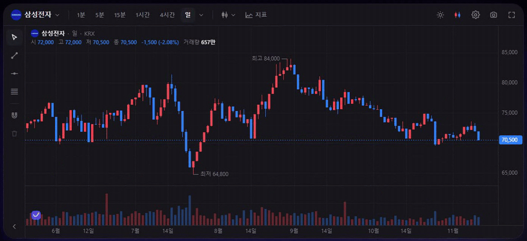
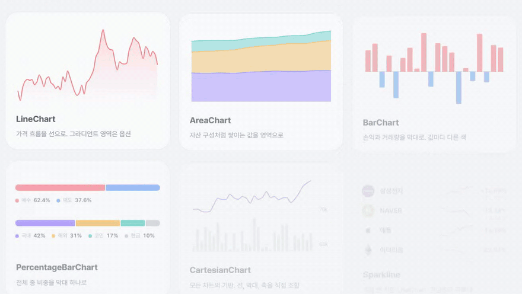

<div align="center">


# Funnest Charts

Open-source financial charts for investment apps.\
A pro-grade trading chart and lightweight dashboard charts, with your data and your design.

[](https://www.npmjs.com/package/@funnest/charts-react)
[](LICENSE)

[Website](https://charts.funnest.xyz) · [Docs](https://charts.funnest.xyz/docs/) · **English** | [한국어](README.ko.md)

</div>



## Why

- Runs in your page, not an iframe.\
  Background, fonts and up/down colors follow your design tokens.
- Positions, open orders and fills on the chart, with drag-to-modify orders.
- Mouse and touch: pinch zoom, long-press crosshair, inertial scrolling.
- Korean market defaults: KST, KRX sessions and tick sizes, red-up / blue-down.
- No exchange code inside.\
  Connect any exchange or broker through one `Datafeed` interface.

## Quick start

```bash
npm i @funnest/charts-react
```

```tsx
import { FnChart } from '@funnest/charts-react';

<div style={{ height: 600 }}>
  <FnChart datafeed={myDatafeed} symbol="005930" resolution="1D" />
</div>
```

One package is enough for React.\
It brings in the engine, the trading UI and the chart math automatically.

## Dashboard charts



For return cards, watchlists and portfolios that don't need a full trading screen.\
They are SVG and safe for server rendering.

```tsx
import { LineChart, ReferenceLine, Point } from '@funnest/charts-react';

<LineChart series={[{ id: 'price', data: prices }]} area="gradient" scrubber={{ showValues: true }}>
  <ReferenceLine dataY={avgPrice} label="Avg. price" />
  <Point seriesId="price" dataX={prices.length - 1} pulse />
</LineChart>
```

| Component | Use |
|---|---|
| `LineChart` · `AreaChart` · `BarChart` | Price history, composition (`stacked`), P&L and volume, horizontal rankings (`layout="horizontal"`) |
| `PercentageBarChart` | Portfolio weights, buy/sell pressure, several rows or vertical columns |
| `CartesianChart` | Compose your own from `Line`, `Area`, `BarPlot`, axes and annotations; several y axes (`yAxisId`) and `[low, high]` ranges for bands and floating bars |
| `XAxis` · `YAxis` · `Scrubber` · `PeriodSelector` | Axes, pointer tracking with value tooltips, period tabs |
| `ReferenceLine` · `Point` · `Legend` | Average/target price lines, trade markers, legends |

## Packages

| Package | What it is |
|---|---|
| [`@funnest/charts-react`](packages/react) | React: the `<FnChart />` trading chart and the SVG chart components |
| [`@funnest/charts-ui`](packages/ui) | Trading chart widget for any framework (`createTradingChart`) |
| [`@funnest/charts`](packages/core) | Canvas engine, indicators and realtime helpers |
| [`@funnest/charts-viz`](packages/viz) | Platform-neutral chart math shared by web and React Native |
| [`@funnest/charts-cli`](packages/cli) | `funnest-charts` command: validate specs, render SVG/PNG/HTML, generate React code |
| [`@funnest/charts-mcp`](packages/mcp) | MCP server for AI tools such as Claude Code and Cursor |

## AI · CLI · MCP

```bash
npx @funnest/charts-cli render spec.json --out chart.png      # spec → PNG / SVG / HTML / React code
claude mcp add funnest-charts -- npx -y @funnest/charts-mcp   # add the MCP server to Claude Code
```

The agent skill is in [`skills/funnest-charts`](skills/funnest-charts/SKILL.md).\
A summary for LLMs is at [`/llms.txt`](https://charts.funnest.xyz/llms.txt).

## Theme

The trading chart follows the OS light/dark setting by default and switches live (`colorScheme: 'system'`).\
Pin it with `'light'` or `'dark'`, or override colors with `theme`.\
The SVG components follow the page's `color-scheme` and the `--fnv-*` CSS variables.

## Logo badge

The trading chart shows a small Funnest logo in its bottom-left corner.\
Turn it off with `attribution: false`.\
If you use Funnest Charts for free, keeping it on is the best way to support the project.

## Development

```bash
pnpm install
pnpm dev          # playground (http://localhost:5173)
pnpm site         # website and docs (http://localhost:3100)
pnpm test         # unit tests
pnpm test:site    # build the website and run browser checks
pnpm typecheck
pnpm build
```

Releases are published from GitHub Actions with npm Trusted Publishing.\
Bump the versions in `packages/*/package.json`, commit, then push a tag such as `git tag v0.1.1 && git push origin v0.1.1`.

## License

Code is [Apache-2.0](LICENSE).\
The Funnest name and logos are trademarks and are not covered by the license ([NOTICE](NOTICE)).
